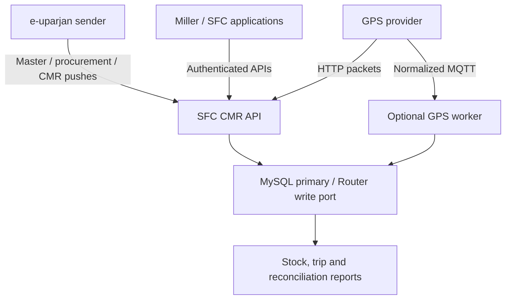
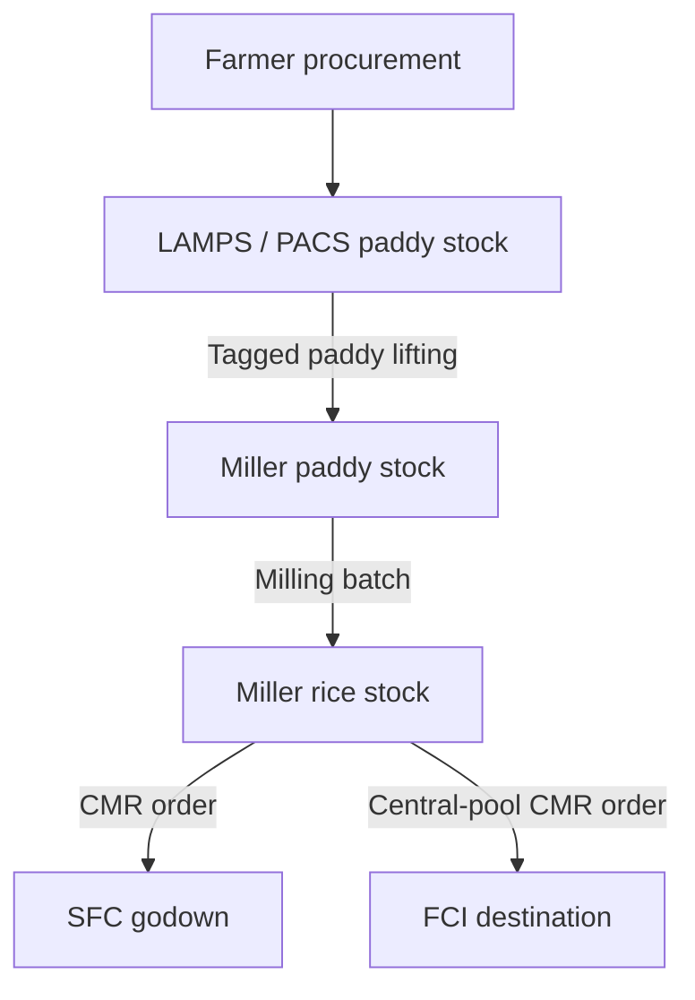
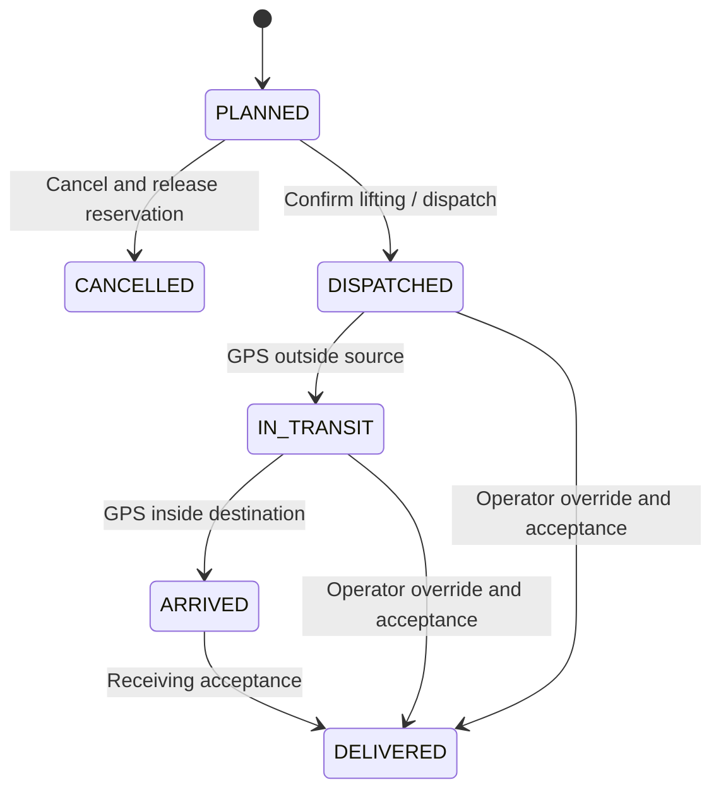

# Workflow and accounting rules

## Architecture

The independent service uses one MySQL pool. All critical inventory operations use InnoDB transactions, row locks, uniqueness constraints and guarded arithmetic. The same primary/write endpoint also serves operational reads to avoid a stale replica affecting an allocation decision. Each facility serializes its stock changes; unrelated facilities can progress independently.

## Physical supply chain

### 1. Registration and tagging

Current interim setup: DM users use **Masters → CMR setup** to assign receiving depots, create orders and register vehicles directly against a miller. Transporter-based registration remains in the code for future use but is not shown in the current Miller UI. Test rice can temporarily be entered through the explicitly enabled test-stock function, recorded separately from real production; procurement/milling completion is deferred. Sample seed records are labelled SAMPLE/TEST and are not evidence of a real receipt or GPS connection.

Registered Miller users log in through the frontend's CMR checkbox. Their CMR portal provides module-controlled Dashboard, Masters (own transporters, vehicles and GPS devices), Reports (stock, ledger and season reconciliation), and Profile. Profile includes name/email editing, change password and logout. CMR ADMIN controls MILLER role module assignments through the CMR portal; the core DM's module assignments are managed by the existing core system. Menu visibility follows assigned modules, while CMR API checks enforce both action permissions and miller ownership.

- Register the season, farmers and facilities with their stable source codes.
- Facility `kind` distinguishes `PACS`, `LAMPS`, `MILLER`, `SFC_GODOWN`, `FCI`.
- Every site has latitude, longitude, radius in metres and storage capacity.
- Millers can have a daily paddy-processing capacity. Storage capacity covers paddy plus rice across all seasons. Neither field is a vehicle capacity.
- Tag source LAMPS/PACS to a miller for a season. Separately tag that miller to allowed SFC/FCI destinations.
- An administrator creates the miller's login. The miller creates its own transporter, vehicle and GPS device records. A transporter login can register vehicles and devices within its assigned transporter.
- This release assigns each transporter record to one miller and each vehicle to one transporter. A vehicle/IMEI is unique across the service. Reassigning ownership/IMEI is intentionally not exposed as an ordinary profile edit; historical mappings remain stable.

### 2. Farmer procurement

An e-uparjan procurement push references a farmer code, PACS/LAMPS code and season code. Successful import increases paddy on hand and creates a traceable lot. Unknown codes fail; a bulk request is all-or-nothing. There is no automatic registration of an unknown farmer from a procurement record.

Each `external_ref` is unique across all seasons. Prefix it with system/year/receipt if the source reuses numbers. Repeating the same normalized record returns its existing ID. Changing a value against the same reference returns HTTP 409. A different JSON field order is harmless; callers should retain the same units, values and timestamp representation for retries.

### 3. Paddy consignment

1. Allocate a quantity to a tagged miller and an available vehicle belonging to that miller.
2. Explicit lot allocations must total the consignment quantity; omit `lots` for FIFO by procurement time and ID.
3. Allocation increases `reserved_g`; it does not remove physical on-hand stock.
4. A vehicle can have only one active consignment (`PLANNED`, `DISPATCHED`, `IN_TRANSIT`, `ARRIVED`). Database uniqueness also enforces this under concurrency.
5. At dispatch, on-hand and reserved quantities both decrease; farmer lot availability and reservations decrease in the same transaction.
6. A receiving miller records accepted weight after GPS arrival. An SFC operator can instead provide an explicit, audited GPS override reason.
7. Accepted paddy increases miller stock; dispatched minus accepted is recorded as transit shortage.
8. Expected rice obligation = accepted paddy × the consignment's frozen recovery percentage.

Only `PLANNED` consignments may be cancelled. Cancellation releases stock and lot reservations. Dispatched goods cannot be put back into stock by a simple status change.

### 4. Milling

Record the paddy input, batch number, timestamp and optionally measured rice output. If rice output is omitted, the configured ratio determines it. The transaction consumes miller paddy and adds rice; rice output must be positive and cannot exceed paddy input. Daily paddy capacity, when configured, is enforced using the Asia/Kolkata business day.

The receipt-based rice obligation and batch-based production expectation are separate measurements. Changing the default recovery ratio affects new consignments/batches only. Actual measured production can differ from expected output; reports show the variance rather than rewriting received-paddy obligations.

### 5. CMR order and rice delivery

The Miller CMR submission form creates one planned consignment for one vehicle. It records date, quantity, driver details, stenciling code and bag metadata against an eligible order and assigned SFC/FCI destination. Submission reserves rice stock and order quantity without dispatching or reducing physical stock. Driver details are saved at submission; the existing manual dispatch endpoint still accepts its required driver fields. Geofence-triggered dispatch from PLANNED is future work. CMR form lot count is metadata and does not allocate incoming farmer/procurement lots.

An imported CMR order identifies its season, miller, tagged SFC/FCI destination, rice quantity, due date and source order reference. Paddy-based official order formats must be converted to an explicit rice quantity by the sender according to the agreed rule; the receiver will not guess the source unit.

Rice allocation reserves both miller rice stock and the order balance. Multiple trips can serve an order. `delivered_g + committed_g` must never exceed its target. All accepted rice deliveries require an `ADMIN` or `OPERATOR`; a miller cannot self-accept CMR delivery. SFC/FCI accepted rice becomes destination stock.

At receipt, the full dispatched commitment is released and accepted quantity is credited. A shortage therefore reopens that quantity for a replacement consignment. The order becomes `FULFILLED` only when its accepted deliveries equal the target. An unused order can be cancelled; its quantity can otherwise be amended only above existing committed plus delivered quantity.

### State transitions

GPS arrival never credits inventory or confirms quantity. A destination packet can prove the vehicle is both outside the source and inside the destination, so the first post-dispatch packet may create departure and arrival at the same recorded time. This does not establish the exact physical departure time during a telemetry gap.

## GPS ordering and history

- All API timestamps require ISO 8601 with `Z` or an explicit offset. Stored and returned timestamps are UTC. Display IST in the client; do not add 5:30 twice.
- `gps_fix` must be true. Coordinates and speed are range-checked.
- Each `(device_id, gps_at)` is unique. An identical coordinate retry is a duplicate; different coordinates at the same timestamp are a conflict. Higher-frequency sources must provide millisecond timestamps.
- A batch is sorted by GPS time; each packet has its own transaction. HTTP 207 reports per-packet failures while retaining successful packets.
- Device latest position and the consignment's last-processed time are independent. Older packets are retained in history but cannot move an already-processed trip backwards.
- Source/destination coordinates and radii are snapshotted on allocation. Later master corrections apply to new consignments.
- GPS geofence events, departure, arrival and manual receipts are recorded in the consignment event timeline.
- History queries use an inclusive `from` and exclusive `to`, at most seven days per request, with pagination.
- Late history is not automatically replayed over a trip already advanced by newer telemetry. Send offline batches oldest-first before resuming newer data if exact historic transitions matter. There is no InfluxDB backfill worker in this standalone project.
- A stale latest device position is flagged after `GPS_STALE_MINUTES` (default 15). No road-route deviation calculation or driver call escalation is claimed.

## Balances and traceability

| Balance | Meaning |
|---|---|
| `on_hand_g` | Physical stock currently received but not dispatched/consumed |
| `reserved_g` | Part of on-hand stock committed to planned shipments |
| Available | `on_hand_g - reserved_g` |
| Paddy obligation | Sum of accepted paddy receipt obligations at their frozen ratios |
| Rice delivered | Sum of accepted SFC/FCI CMR deliveries |
| Obligation balance | Expected receipt-based rice minus accepted rice deliveries; negative values expose excess delivery |
| Order unallocated | Ordered rice minus accepted deliveries minus active commitments |
| Production variance | Actual/generated rice production minus batch expected rice |

Every stock mutation has a ledger entry. Procurement-to-paddy-consignment lot links retain farmer traceability. Milling and rice storage are pooled by miller and season; this version does not assign a specific farmer's grain to a particular rice batch or CMR bag. Shortages are recorded per consignment, not arbitrarily apportioned to farmers.

AGM / Lifting Incharge CMR receiving

Open CMR in the main navigation. The tab uses existing AGM/Lifting dashboard view permissions (33/25), while the CMR service independently verifies user types 4/8 and active store assignments. Select View / Receive on a shipped CMR, enter stacks and received quantities/bags, enter gross and empty-bag weights, and record rice quality measurements. Confirm compliance to approve or provide a rejection reason. The screen shows calculated net quantity and shortage; backend validates all calculations. Received stock shows accepted stack history plus current rice balances. Receipts are final; return resolution for rejected rice remains a separate future flow. Planned submissions must first be dispatched through the existing transport flow; this screen does not dispatch vehicles.
